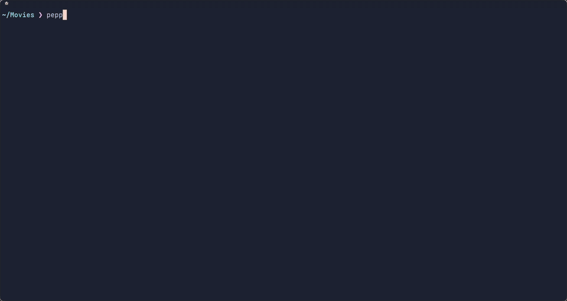

<p align="center">
  
</p>

<h1 align="center">Pepper</h1>

<p align="center">
  <b>Ghostty, with video inside the terminal.</b>
  <br>
  <a href="#install">Install</a>
  ·
  <a href="#play-video">Play video</a>
  ·
  <a href="#pepper-for-ai-agents">AI agents</a>
  ·
  <a href="#ghosttys-terminal-untouched">What it changes</a>
  ·
  <a href="#security">Security</a>
  ·
  <a href="pepper-play/README.md">For developers</a>
</p>

<p align="center">
  
  <br>
  <sub><code>pepper-play</code> in a Pepper tab; <code>f</code> fills the tab. Big Buck Bunny © Blender Foundation, <a href="https://creativecommons.org/licenses/by/3.0/">CC BY 3.0</a>.</sub>
</p>

Pepper is [Ghostty](https://ghostty.org) 1.3.1, the terminal, with one thing added: a program can play a video in a box of cells inside a tab. The video goes straight from the graphics chip to the screen, with no copies. In a Pepper tab, a 1080p video at 30 frames a second costs about half the CPU and under half the memory of mpv playing it in its own window with the same settings (decoded on the graphics chip, timed to the display), and Pepper itself adds 1–2% of a core ([measured](pepper-play/README.md#performance)).

It's named after Pepper's ghost, the stage trick that lays a picture over the live scene.

## Ghostty's terminal, untouched

Pepper is Ghostty. It draws text, reads your keys and runs your shell with Ghostty's own code, unchanged. In what programs print, it understands one more escape sequence, and that's its only change to Ghostty's core. It reads your Ghostty config (`~/.config/ghostty/config`), and it installs next to Ghostty, which keeps working as before.

Everything Pepper adds to Ghostty 1.3.1 is in this table, and in [a handful of commits](https://github.com/ghostty-org/ghostty/compare/v1.3.1...erictran308:pepper:pepper) you can read in an evening:

| Where | What Pepper adds | Size |
| --- | --- | --- |
| Ghostty's core (Zig) | One escape sequence, `OSC 777;pepper`, which places a video box. | 332 lines, tests included |
| The macOS app (Swift) | One new file, [`PepperServer.swift`](macos/Sources/Features/Pepper/PepperServer.swift), which takes frames from a player and shows them over the box. | 693 lines, plus 22 that hook it in |
| Ghostty's updater | Taken out: Sparkle and its update screens. Ghostty's releases would install over Pepper, and without it Pepper loads no code but its own and the system's. *Check for Updates…* says where new releases are. | About 2,100 lines fewer |
| The player (Rust) | [`pepper-play`](pepper-play/), a program of its own inside the app. Pepper never starts it: you do, or a program you run does. | Separate program |
| A helper for AI agents (Rust) | [`pepper-agent`](pepper-agent/), a program of its own inside the app: a viewer pane you run, and commands an AI agent runs to show you video there. Pepper never starts it either. | Separate program |
| The name and icon | "Pepper" in menus, About and alerts, its own app id and icon, so it can't be confused with Ghostty or replace it. | Text and images |
| The build | Builds with Zig 0.15.2 on Apple's newest SDKs, plus one fix from Ghostty's own later code. Signs Pepper and its player with macOS's hardened runtime, and checks what their signatures allow. | Build files only |

Nothing else changes. Pepper adds no new way to run a command, and it doesn't update itself.

Pepper follows Ghostty: each new Ghostty release, the same changes move onto it.

## Install

1. Download `Pepper.zip` from [Releases](https://github.com/erictran308/pepper/releases), unzip it, and drag `Pepper.app` to Applications.
2. Open it. macOS refuses the first time, because Pepper isn't notarized by Apple: it's signed ad hoc, without a paid Apple developer account. Open **System Settings → Privacy & Security**, scroll down to the message about Pepper, and click **Open Anyway**.
3. To play video, install mpv (and yt-dlp, for web addresses): `brew install mpv yt-dlp`.

It runs on Apple silicon Macs. It's built and tested on macOS 27; Ghostty itself runs on macOS 13 and later.

## Play video

In a Pepper tab:

```sh
pepper-play video.mp4
pepper-play 'https://www.youtube.com/watch?v=…'
```

The video fills the tab, with a status line at the bottom. mpv's keys work: space pauses, the arrows seek, `f` covers the status line too, and `q` quits and gives the screen back as it was. ⌘↩ makes Pepper's window full screen, and the video grows with it. It shows in macOS's Now Playing, and the media keys work.

[tuitube](https://github.com/erictran308/tuitube), a YouTube client for the terminal, plays its videos inside Pepper too: on the video's page, and in a small box while you browse.

Any program can do the same. [`pepper-play/README.md`](pepper-play/README.md) explains how, with examples in shell, Python and Rust.

## Pepper for AI agents

An AI coding agent (Claude Code, Codex, Gemini CLI, Aider, your own) can show you video in Pepper and hear back what you point out. Open a split next to the agent (⌘D) and run:

```sh
pepper-agent view
```

That pane becomes the agent's screen. The agent opens a video in it, tells you what to watch on the line at the bottom, and plays the parts it wants you to see; you press `m` to mark a moment, `n` to write a note, and Enter when you're done, and the agent gets your marks with their times. It sees the same frames you do, as pictures made from the file, never from your screen.

An agent finds out how with `pepper-agent guide`, and one line in its instructions tells it to look. [`pepper-agent/README.md`](pepper-agent/README.md) has that line and the rest: the keys, the commands, how it works. It's built in stages: this one does video review; web previews, editing, recordings, devices and streams come next.

## Security

A terminal sees everything you type and runs your commands, so what Pepper adds is kept small, and none of it can run anything:

- **The escape sequence only places a box.** It holds a token and four numbers: where the box goes, in cells. No file names, no commands. Anything else is refused.
- **Pepper shows pictures, nothing more.** Its message port takes only frames already on the graphics chip, and the number of the one to show. Every message is checked for its size and kind, and the rest are dropped. A stream answers only to the program that started it. There are limits on how many streams and boxes there can be, and a tab's output can use up only its own boxes.
- **A video shows only where it was placed, by the same random token.** A program must be able to write to that tab and know the token. Frames sent with any other token show nowhere, and a box never shows outside its tab.
- **The player runs on its own.** `pepper-play` is a separate program, started by you or by a program you run, with the same rights as any other. Pepper only tells your shell where it is.
- **An agent gets a viewer, not your screen.** `pepper-agent view` runs only when you start it, in a pane of yours. An agent's commands reach it through a socket only your user can open, and it does only what those commands say: open a file or a video's web address, play, seek, take a frame from the file, show a line of text. Nothing is passed on to mpv, and nothing an agent sends is run. What it shows the agent are files made from the video, never a capture of the screen.
- **Nothing a video says reaches your terminal raw.** A video's tags, subtitles, a playlist or a web page could hold escape sequences. From a shell, mpv prints nothing to the terminal: pepper-play draws the status line itself, from numbers, subtitles and mpv's on-screen text are drawn inside the video's box, and mpv's errors are shown with any control characters escaped. (Your own mpv options, such as `--term-title` or `--msg-level`, can turn mpv's terminal output back on.)
- **Signed to keep code out.** Pepper and pepper-play run with macOS's hardened runtime: no debugger can attach, and `DYLD_` variables can't put code in them. Pepper loads no libraries but its own and the system's.

The most a program can do with what Pepper adds: show a picture in a box of a tab it can already write to. It can't read the screen, type into a tab, or start anything.

In October 2026 everything Pepper adds, and tuitube's use of it, went through a strict security review. It found no way for terminal output or another program to run a command. It found seven weaknesses, all fixed before the first release:

1. pepper-play printed mpv's messages as they came, so a video's tags could send escape sequences to the terminal.
2. The build kept a debugging permission Xcode adds, so a debugger could attach to Pepper.
3. pepper-play ran without the hardened runtime.
4. Ghostty's updater, unused, kept macOS's library check off.
5. Output in one tab could use up the video boxes of every tab.
6. and 7. Two ways a local program could upset Pepper's bookkeeping of the Mach ports it holds.

A second review, of the changes after that release, found one more: from a shell, mpv's own status line also printed a video's subtitles, unescaped, when there was no video picture (a sound-only file). A subtitle could change the tab's title or, with Ghostty's default `clipboard-write = allow`, set the clipboard. Fixed: mpv now prints nothing to the terminal, as above.

Found a security problem in what Pepper adds? Please report it privately through [this repository's security advisories](https://github.com/erictran308/pepper/security/advisories/new), not in a public issue ([what's Pepper's](SECURITY.md)). Problems in Ghostty itself belong to [Ghostty](https://github.com/ghostty-org/ghostty/security).

## Build it yourself

Needs full Xcode (with its Metal Toolchain), Zig 0.15.2 exactly, Rust, and `brew install gettext`.

```sh
./pepper-build.sh        # → zig-out/Pepper.app
```

`pepper-build.sh` explains why plain `zig build` doesn't work with Apple's newest SDKs, and what it does about it.

## Credits and licence

Pepper is Ghostty, by Mitchell Hashimoto and Ghostty's contributors, under the MIT licence ([LICENSE](LICENSE)). All the credit for the terminal is theirs. Please don't report Pepper's problems to Ghostty: open them [here](https://github.com/erictran308/pepper/issues).

Pepper's own code is MIT too. pepper-play loads mpv's library at run time, which is GPL as Homebrew builds it ([details](pepper-play/README.md#licence)).

Ghostty's own README, with its documentation and roadmap: [github.com/ghostty-org/ghostty](https://github.com/ghostty-org/ghostty#readme).
